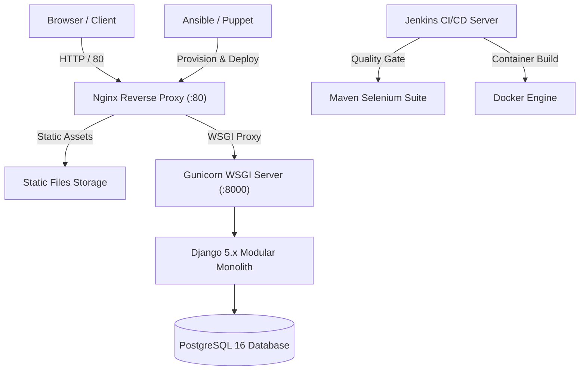

# Puppet-Provisioned Supplier Quality Review Portal

[](https://www.python.org/)
[](https://www.djangoproject.com/)
[](https://www.postgresql.org/)
[](https://maven.apache.org/)
[](https://www.selenium.dev/)
[](https://www.docker.com/)
[](https://www.jenkins.io/)
[](https://www.ansible.com/)
[](https://puppet.com/)

---

## Academic Information

- **Student Name:** AADITYA ASWALE
- **Student ID:** 23102B0044
- **Course / Degree:** Bachelor of Technology / Computer Engineering
- **Project Title:** Puppet-Provisioned Supplier Quality Review Portal
- **DevOps Lifecycle:** 15-Week Authoritative Curriculum (Weeks 1 to 15)

---

> [!NOTE]
> Release Baseline v1.0.0: Enterprise quality governance and automated evaluation baseline.

## Executive Project Overview

The **Supplier Quality Review Portal** is an enterprise-grade SaaS application designed for manufacturing and quality engineering organizations to assess, track, audit, and benchmark supplier performance. It features a complete **Role-Based Access Control (RBAC)** workflow across **Admins**, **Quality Managers**, and **Reviewers**, enabling collaborative audit review generation, automated weighted score calculations, and formal approval/rejection gates.

In addition to rich enterprise software capabilities, this project serves as a comprehensive **DevOps exemplar**, evolving through a full 15-week curriculum:
- **Agile Planning & Requirements:** User stories, DoD, backlog, SRS, and UML models.
- **Git Governance:** Strict branch naming, feature branches, pull requests, merge conflict resolution, and release tagging (`v1.0.0`).
- **Continuous Integration (CI):** Jenkins declarative pipeline, artifact archiving, and linting.
- **Automated Testing & Quality Gates:** Pytest unit tests, standalone **Maven Java Selenium WebDriver** suite with failure screenshot listener, and deliberate defect injection verification.
- **Containerization & CD:** Production multi-stage `Dockerfile`, `docker-compose.yml`, Nginx reverse proxy, and automated container deployment.
- **Configuration Management (IaC):** Automated, idempotent provisioning via both **Ansible Playbooks** and **Puppet Manifests** with automated health checks and rollback support.

---

## Key System Architecture



---

## 15-Week Curriculum Traceability

| Week | Milestone Title | Key Implementation Deliverable |
| :--- | :--- | :--- |
| **Week 1** | Problem Definition & Scope | Problem statement, stakeholder analysis, frozen MVP scope (`docs/01-problem-definition.md`) |
| **Week 2** | Agile Planning & DevOps Workflow | 15-Week sprint plan, backlog, user stories, DoD (`docs/03-user-stories-and-backlog.md`) |
| **Week 3** | Architecture & Tech Setup | SRS, UML diagrams, modular monolith setup (`docs/05-srs.md`, `backend/`) |
| **Week 4** | Git & Repository Initialization | GitHub repo structure, `.gitignore`, branch rules, issue templates |
| **Week 5** | Feature Development & Branching | Branch `feature/supplier-management`, PR review comments, merge to `develop` |
| **Week 6** | MVP Completion & Git Tagging | Full CRUD, RBAC, conflict resolution demo, release tag `v1.0.0` |
| **Week 7** | Jenkins Installation & CI Job | Jenkins controller setup, freestyle/pipeline job, archived build artifact (`.tar.gz`) |
| **Week 8** | Pipeline as Code & Deployment | Declarative `jenkins/Jenkinsfile`, parameterized deployment to Nginx/Gunicorn |
| **Week 9** | Selenium E2E Tests via Maven | Java 17 + Maven 3.9 Selenium WebDriver suite, Page Object Model, screenshot listener |
| **Week 10**| Continuous Testing Quality Gate | Pipeline Selenium integration, deliberate defect failure demo, bugfix commit |
| **Week 11**| Docker Container Lifecycle | Production `Dockerfile`, image build, tag, run, logs, inspect, stop, remove |
| **Week 12**| Jenkins-Docker CD Pipeline | End-to-end commit-to-container continuous deployment |
| **Week 13**| Configuration Management (IaC) | Ansible playbooks (`site.yml`, roles) & Puppet manifests (`site.pp`, modules) |
| **Week 14**| Automated Provisioning & Recovery | Clean-node execution, idempotency check (`changed=0`), `/health/` check, rollback |
| **Week 15**| Final Release, Presentation & Viva | Production release, 22 technical docs in `docs/`, presentation deck, viva defense guide |

---

## Quick Start (Local Development)

### 1. Prerequisites
- Python 3.11+ / 3.12+
- Git 2.40+
- Java JDK 17+ or 23 & Apache Maven 3.9+ (for Selenium suite)
- Google Chrome Browser

### 2. Setup Virtual Environment & Install Dependencies
```powershell
# Navigate to project directory
cd backend

# Create virtual environment
python -m venv venv

# Activate virtual environment
.\venv\Scripts\Activate.ps1

# Install requirements
pip install -r requirements.txt
```

### 3. Database Migrations & Realistic Seed Data
```powershell
# Run migrations
python manage.py migrate

# Populate realistic enterprise seed data (Apex Components, Orion Mfg, etc.)
python manage.py seed_portal
```

### 4. Run Development Server
```powershell
python manage.py runserver
```
Visit: **`http://127.0.0.1:8000/`**

### Pre-Configured Demo Credentials:
- **Admin:** `admin` / `Admin@12345` (Full access, user management)
- **Quality Manager:** `manager` / `Manager@12345` (Review approvals, analytics)
- **Reviewer:** `reviewer` / `Reviewer@12345` (Review creation, draft editing)
