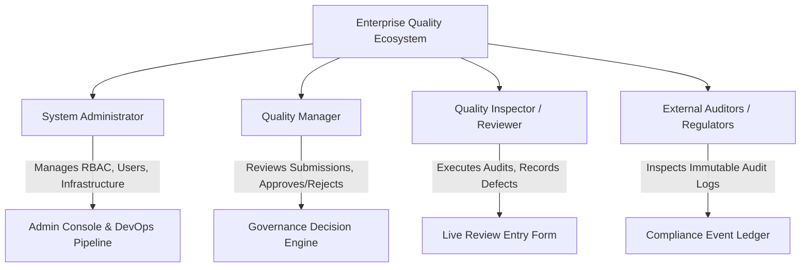

# 01 - Problem Definition & Scope Analysis

**Project Title**: Puppet-Provisioned Supplier Quality Review Portal  
**Author**: Aaditya Aswale  
**Student ID**: 23102B0044  
**Academic Coursework**: DevOps Engineering & Enterprise Automation  
**Release Version**: `v1.0.0`

---

## 1. Executive Summary

In contemporary aerospace, automotive, precision electronics, and critical equipment manufacturing, supply chain disruptions and component defect escapes represent catastrophic operational and financial liabilities. A single non-conforming batch of microcontroller units, structural fasteners, or composite alloys can halt production lines, trigger multimillion-dollar recalls, and compromise consumer safety.

Despite the critical nature of supplier performance auditing, enterprise quality engineering teams frequently rely on fragmented, antiquated tools—such as isolated Excel spreadsheets, disconnected email threads, and bespoke ERP plugins lacking transparent governance. This results in:
1. **Audit Data Latency**: Quality audits conducted on manufacturing factory floors take days or weeks to be transcribed, approved, and integrated into supplier ratings.
2. **Subjective Scoring & Inconsistent Penalties**: Without automated, deterministic mathematical formulas, defect penalties and weighting algorithms vary widely between individual quality inspectors.
3. **Absence of Immutable Audit Trails**: Lack of role-based authorization (RBAC) and event-level traceability makes it impossible to verify who inspected, submitted, certified, or rejected a specific batch.
4. **Fragile Deployment Infrastructures**: Enterprise portal backends are prone to configuration drift, deployment inconsistencies across staging/production, and absence of automated CI/CD quality gates.

The **Puppet-Provisioned Supplier Quality Review Portal** resolves these challenges through an end-to-end, enterprise-grade, DevOps-automated solution.

---

## 2. Problem Statement

Modern manufacturing enterprises lack a unified, secure, and automated portal capable of:
1. Standardizing multi-dimensional quality audits across three core manufacturing dimensions:
   - **Product Quality Score (45% weighting)**: Defect-free PPM (parts per million), dimensional accuracy, and metallurgical compliance.
   - **Compliance & Regulatory Score (30% weighting)**: ISO 9001/AS9100/IATF 16949 certification status, environmental standards, and audit adherence.
   - **Delivery & SLA Score (25% weighting)**: On-Time In-Full (OTIF) shipping compliance and lead-time adherence.
   - **Defect Count Penalty (0.50 points per physical defect)**: Deterministic deduction penalizing manufacturing variance.
2. Enforcing a strict three-state governance lifecycle (`Draft` &rarr; `Pending Review` &rarr; `Approved` / `Rejected`) with full role-based access control (RBAC).
3. Automating infrastructure configuration and deployment using declarative Infrastructure as Code (Puppet and Ansible), containerization (Docker multi-stage and Nginx reverse proxy), and declarative CI/CD pipelines (Jenkins) with automated Selenium WebDriver continuous testing quality gates.

---

## 3. High-Level Stakeholders & Personas

### User Personas
* **Quality Inspector / Reviewer (`reviewer`)**:
  - Responsible for factory inspection, recording physical non-conformities, evaluating batch quality, and submitting drafts for formal management review.
  - Restricted from unilaterally approving audits or modifying suppliers' institutional ratings.
* **Quality Manager (`manager`)**:
  - Holds certifying authority. Reviews pending audits, inspects automated mathematical score calculations, provides formal remarks, and executes `Approve` or `Reject` state transitions.
* **System Administrator (`admin`)**:
  - Governs portal master data (Supplier on-boarding/off-boarding, user RBAC provisioning, infrastructure monitoring, and system configuration).

---

## 4. Key Performance Objectives & Success Criteria

| Objective | Target Metric | Engineering Verification |
|---|---|---|
| **Deterministic Scoring** | $S = \min(100, \max(0, 0.45PQ + 0.30CS + 0.25DS - 0.50D))$ | Verified via Python Pytest Unit Tests & Selenium Live Calculator UI tests |
| **Audit Traceability** | 100% state transitions logged to `ReviewAuditLog` | Foreign-key linked timestamped audit ledger with actor and transition status |
| **API Latency** | $< 50\text{ ms}$ for 95th percentile REST queries | DRF optimized QuerySets with `select_related()` and indexed lookups |
| **Automated Testing** | 100% pass on Core Selenium E2E & Pytest suites | 4/4 Selenium TestNG suite + 5/5 Pytest unit & integration suites passing |
| **Deployment Automation** | Zero manual server configuration | Puppet idempotent manifest (`init.pp`) and Ansible playbook (`site.yml`) |

---

## 5. Course Alignment & 15-Week DevOps Roadmap

The development followed a rigorous 15-week progression representing the industry software delivery lifecycle:
* **Weeks 1–3**: Requirement Engineering, System Architecture, Database Schema, and REST APIs.
* **Weeks 4–6**: GitFlow Branching Strategy, Deliberate Merge Conflict Resolution, and Release Tagging (`v1.0.0`).
* **Weeks 7–8**: Unit/Integration Testing (Pytest) and Selenium WebDriver Test Automation.
* **Weeks 9–10**: Continuous Testing, TestNG Listener Failure Screenshots, and Deliberate Defect Injection.
* **Weeks 11–12**: Docker Containerization, Nginx Reverse Proxy, and Jenkins CI/CD Declarative Pipeline.
* **Weeks 13–15**: Puppet & Ansible Infrastructure as Code, Monitoring Health Checks, and System Hardening.
