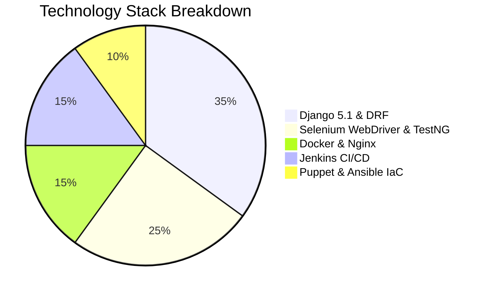

# 02 - Software Requirements Specification (SRS)

**Project Title**: Puppet-Provisioned Supplier Quality Review Portal  
**Author**: Aaditya Aswale (Student ID: 23102B0044)  
**Standard Compliance**: IEEE 830-1998 Recommended Practice for SRS  
**Target Release**: `v1.0.0`

---

## 1. Introduction

### 1.1 Purpose
This document provides a comprehensive specification of the functional, non-functional, behavioral, and architectural requirements for the Supplier Quality Review Portal. It serves as the authoritative contract between development, quality assurance, DevOps, and project evaluation committees.

### 1.2 Scope of the System
The portal provides enterprise supplier management, deterministic multi-criteria quality scoring, governance review workflows, continuous health monitoring, automated testing, and Puppet/Ansible-driven infrastructure automation.

---

## 2. Functional Requirements (FR)

### Module 1: Authentication & Role-Based Access Control (RBAC)
* **FR-AUTH-01**: The system shall provide secure session-based authentication for web users and token-based authentication for external REST API clients.
* **FR-AUTH-02**: The system shall enforce three distinct operational roles:
  1. `ADMIN`: Full access to supplier CRUD, user management, review workflows, system health, and raw audit logs.
  2. `QUALITY_MANAGER`: Certifying authority. Permitted to review submitted drafts, execute approvals or rejections, and view executive analytics.
  3. `REVIEWER`: Quality inspector. Permitted to create draft audits, record defects, and submit reviews for manager approval.
* **FR-AUTH-03**: The system shall enforce RBAC at the Django Model and DRF Permission levels, forbidding unauthorized role escalation via direct URL or API tampering.

### Module 2: Supplier Master Data Management
* **FR-SUP-01**: The system shall support CRUD operations on manufacturing suppliers, capturing: `code` (e.g. `APEX-IND`), `name`, `contact_name`, `contact_email`, `phone`, `country`, `status` (`Active`, `Suspended`, `Under Review`), and calculated `grade` (`A+`, `A`, `B`, `C`, `D`).
* **FR-SUP-02**: The system shall recalculate the supplier's cumulative `overall_quality_score` as the arithmetic mean of all `Approved` reviews belonging to that supplier.
* **FR-SUP-03**: The system shall provide real-time search and country/status filtering on the Supplier Directory page.

### Module 3: Quality Review Scoring Engine & Workflow
* **FR-REV-01**: The system shall calculate the audit score according to the weighted formula:
  $$\text{Overall Score} = \min(100.00, \max(0.00, (\text{PQ} \times 0.45) + (\text{CS} \times 0.30) + (\text{DS} \times 0.25) - (\text{Defects} \times 0.50)))$$
* **FR-REV-02**: The user interface shall feature a client-side reactive calculator updating the overall score and letter grade in real time as the inspector types audit metrics.
* **FR-REV-03**: The review lifecycle shall enforce valid state transitions:
  - `Draft` &rarr; `Pending Review` (initiated by Reviewer or Manager)
  - `Pending Review` &rarr; `Approved` (Manager only, updates Supplier cumulative score)
  - `Pending Review` &rarr; `Rejected` (Manager only, leaves Supplier cumulative score untouched)
* **FR-REV-04**: Every state transition shall generate an immutable entry in `ReviewAuditLog` recording `actor`, `action`, `old_status`, `new_status`, `timestamp`, and `notes`.

### Module 4: RESTful API Services
* **FR-API-01**: The system shall expose authenticated endpoints:
  - `/api/v1/suppliers/` (GET, POST, PUT, DELETE)
  - `/api/v1/reviews/` (GET, POST, PUT, DELETE, plus custom action `/transition/`)
  - `/api/v1/dashboard/metrics/` (Aggregated KPIs and Chart series data)
  - `/health/` (Public liveness/readiness probe verifying database connectivity)

---

## 3. Non-Functional Requirements (NFR)

### 3.1 Performance Requirements
* **NFR-PERF-01**: Average REST API response time for supplier and review lookups shall remain $< 50\text{ ms}$ under a load of 100 concurrent requests.
* **NFR-PERF-02**: Page load times for the dashboard shall not exceed $1.2\text{ seconds}$ on broadband connections.

### 3.2 Security Requirements
* **NFR-SEC-01**: CSRF protection shall be enforced across all POST/PUT/DELETE web form actions.
* **NFR-SEC-02**: Passwords shall be hashed using PBKDF2 with SHA256 hashing algorithm and minimum 600,000 iterations.
* **NFR-SEC-03**: Sensitive settings (database credentials, secret keys) must be decoupled from source code using environment variables.

### 3.3 Reliability & Availability
* **NFR-REL-01**: The application shall implement automated liveness and readiness health checks responding with HTTP 200 and JSON status payload.
* **NFR-REL-02**: Database integrity shall be preserved using ACID-compliant relational transactions during review score approvals and supplier updates.

---

## 4. Software & Hardware Constraints

* **Backend Environment**: Python 3.12+, Django 5.1.x, Django REST Framework 3.15.x.
* **Continuous Testing**: Java 17+, Maven 3.9+, Selenium WebDriver 4.20+, TestNG 7.9+.
* **Database**: PostgreSQL 16 (Production) / SQLite 3 (Dev/Test).
* **Container Runtime**: Docker 26+, Docker Compose v2.
* **Configuration Management**: Puppet 7/8 Declarative Manifests, Ansible 8+.
