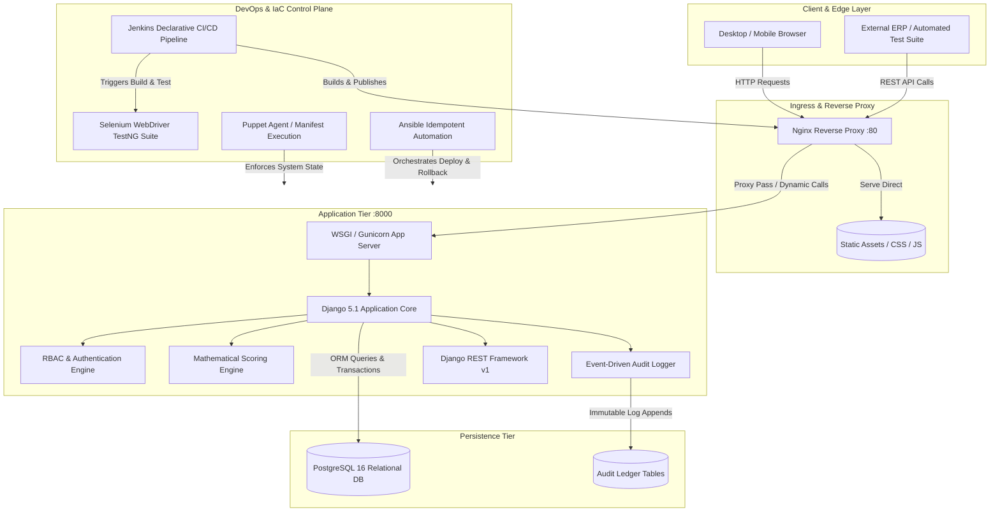
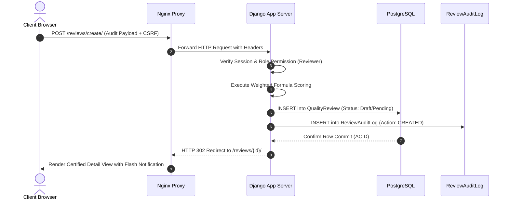

# 03 - System Architecture & Component Interaction

**Project Title**: Puppet-Provisioned Supplier Quality Review Portal  
**Author**: Aaditya Aswale (Student ID: 23102B0044)  
**Architecture Paradigm**: Decoupled Layered Architecture with Microservices-Ready API Gateway & Idempotent IaC  
**Release**: `v1.0.0`

---

## 1. Architectural Philosophy

The Supplier Quality Review Portal is engineered around four core tenets:
1. **Separation of Concerns**: Strict boundary definition between presentation (Templates/Chart.js), business logic (Django Models & Scoring Engine), service/API layer (DRF ViewSets), and persistence (PostgreSQL/SQLite).
2. **Idempotence & Declarative Infrastructure**: Infrastructure configuration defined purely through code (Puppet DSL & Ansible Playbooks), enabling zero-touch reproducible provisioning across staging and production.
3. **Continuous Testing Quality Gates**: Automated gates enforcing that no build is containerized or released without passing both backend unit/integration tests and headless Selenium end-to-end browser tests.
4. **Resilience & Observability**: Nginx reverse proxy providing load buffering, static asset offloading, and standard health monitoring probes for orchestrators.

---

## 2. Multi-Tier Architecture Diagram

---

## 3. Component Breakdown

### 3.1 Web & Reverse Proxy Tier (`infrastructure/nginx/`)
* **Role**: Primary ingress controller, SSL termination point (production), and static asset CDN emulator.
* **Key Configuration**:
  - Upstream load balancing to Gunicorn / Django application server on `web:8000`.
  - Direct, non-blocking caching and streaming of `/static/` and `/media/` files.
  - Proxy buffer tuning (`proxy_buffers 16 16k; proxy_buffer_size 32k;`) and timeout enforcement.

### 3.2 Application Tier (`backend/`)
* **`apps/accounts`**: Custom `UserProfile` model extending `django.contrib.auth.models.User`, enforcing RBAC permissions (`ADMIN`, `QUALITY_MANAGER`, `REVIEWER`).
* **`apps/suppliers`**: Manages vendor profiles, geographical metadata, contact dossiers, and cumulative quality grade scoring.
* **`apps/reviews`**: Core workflow engine containing `QualityReview` models, status state machine, and `ReviewAuditLog` ledger.
* **`apps/dashboard`**: Aggregation engine delivering real-time executive KPIs, grade distribution analytics, defect frequency matrices, and Chart.js series data.
* **`apps/reports`**: Data export services generating CSV audit reports and analytics summaries.
* **`apps/core`**: System health probe (`/health/`), shared middleware, context processors, and error handling controllers.

### 3.3 Persistence Tier (`PostgreSQL / SQLite`)
* **PostgreSQL 16**: Production-grade relational database running in containerized deployment with volume persistence.
* **SQLite 3**: Zero-configuration embedded database for fast, lightweight local development and CI execution.

---

## 4. Security & Isolation Architecture

1. **Defense in Depth**: Every request traverses Nginx header filtering, Django `SecurityMiddleware`, CSRF token validation, session verification, and object-level permission checking.
2. **ACID Transaction Boundaries**: Supplier rating updates occur inside `transaction.atomic()` blocks, ensuring that if any calculation or database write fails, all changes rollback instantly.
