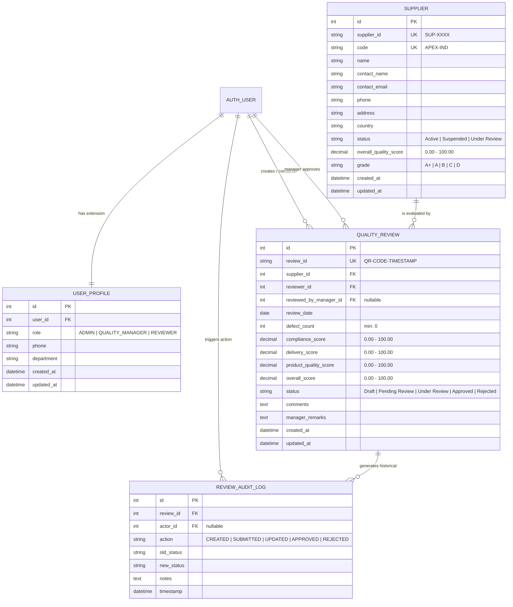

# 04 - Database Design & Relational Schema

**Project Title**: Puppet-Provisioned Supplier Quality Review Portal  
**Author**: Aaditya Aswale (Student ID: 23102B0044)  
**Database Engines**: PostgreSQL 16 (Production) / SQLite 3 (Dev/Test)  
**ORM**: Django 5.1 Object-Relational Mapper  

---

## 1. Relational Entity-Relationship Diagram (ERD)

---

## 2. Table Specifications & Data Dictionaries

### 2.1 Table: `accounts_userprofile`
Extends the standard Django authentication user with enterprise role classification and organizational department context.

| Column | Type | Constraints | Description |
|---|---|---|---|
| `id` | `INTEGER` | `PRIMARY KEY AUTOINCREMENT` | Unique profile identifier |
| `user_id` | `INTEGER` | `FOREIGN KEY (auth_user.id) UNIQUE` | Cascading one-to-one link to auth user |
| `role` | `VARCHAR(20)` | `NOT NULL, DEFAULT 'REVIEWER'` | RBAC Role (`ADMIN`, `QUALITY_MANAGER`, `REVIEWER`) |
| `phone` | `VARCHAR(20)` | `NULLABLE` | Contact telephone number |
| `department` | `VARCHAR(100)` | `DEFAULT 'Quality Assurance'` | Assigned organizational division |
| `created_at` | `TIMESTAMP` | `NOT NULL, AUTO_NOW_ADD` | Timestamp of profile registration |
| `updated_at` | `TIMESTAMP` | `NOT NULL, AUTO_NOW` | Timestamp of last modification |

### 2.2 Table: `suppliers_supplier`
Master repository of all registered supply chain partners and cumulative quality standing.

| Column | Type | Constraints | Description |
|---|---|---|---|
| `id` | `INTEGER` | `PRIMARY KEY AUTOINCREMENT` | Internal database surrogate key |
| `supplier_id` | `VARCHAR(20)` | `UNIQUE, NOT NULL` | Business identifier (e.g. `SUP-1001`) |
| `code` | `VARCHAR(20)` | `UNIQUE, NOT NULL, INDEXED` | Short acronym (e.g. `APEX-IND`) |
| `name` | `VARCHAR(150)` | `NOT NULL, INDEXED` | Legal registered corporate entity name |
| `contact_name`| `VARCHAR(100)` | `NOT NULL` | Primary representative person |
| `contact_email`| `VARCHAR(254)` | `NOT NULL` | Quality escalation email address |
| `phone` | `VARCHAR(30)` | `NULLABLE` | Telephone number |
| `address` | `TEXT` | `NULLABLE` | Physical manufacturing plant location |
| `country` | `VARCHAR(100)` | `NOT NULL, INDEXED` | Sovereign jurisdiction / country |
| `status` | `VARCHAR(20)` | `NOT NULL, DEFAULT 'Active'` | `Active`, `Suspended`, `Under Review` |
| `overall_quality_score`| `DECIMAL(5,2)` | `NOT NULL, DEFAULT 0.00` | Cumulative arithmetic mean of approved audits |
| `grade` | `VARCHAR(5)` | `NOT NULL, DEFAULT 'B'` | Letter rating (`A+`, `A`, `B`, `C`, `D`) |
| `created_at` | `TIMESTAMP` | `NOT NULL, AUTO_NOW_ADD` | Record registration timestamp |
| `updated_at` | `TIMESTAMP` | `NOT NULL, AUTO_NOW` | Last record update timestamp |

### 2.3 Table: `reviews_qualityreview`
Transactional audit events recording component evaluation parameters, defects, and approvals.

| Column | Type | Constraints | Description |
|---|---|---|---|
| `id` | `INTEGER` | `PRIMARY KEY AUTOINCREMENT` | Internal primary key |
| `review_id` | `VARCHAR(40)` | `UNIQUE, NOT NULL, INDEXED` | Human-readable audit ID (`QR-APEX-261004...`) |
| `supplier_id` | `INTEGER` | `FOREIGN KEY (suppliers_supplier.id) NOT NULL` | Target supplier under audit |
| `reviewer_id` | `INTEGER` | `FOREIGN KEY (auth_user.id) NOT NULL` | Inspector conducting evaluation |
| `reviewed_by_manager_id`| `INTEGER`| `FOREIGN KEY (auth_user.id) NULLABLE` | Certifying manager executing decision |
| `review_date` | `DATE` | `NOT NULL` | Official date of physical factory inspection |
| `defect_count`| `INTEGER` | `NOT NULL, MIN_VALUE(0)` | Quantity of non-conforming items discovered |
| `compliance_score`| `DECIMAL(5,2)`| `NOT NULL, RANGE(0.00, 100.00)` | Regulatory ISO/AS score (30% weight) |
| `delivery_score`| `DECIMAL(5,2)`| `NOT NULL, RANGE(0.00, 100.00)` | SLA delivery fulfillment score (25% weight) |
| `product_quality_score`| `DECIMAL(5,2)`| `NOT NULL, RANGE(0.00, 100.00)` | Physical sample test score (45% weight) |
| `overall_score`| `DECIMAL(5,2)`| `NOT NULL, RANGE(0.00, 100.00)` | Deterministically computed weighted score |
| `status` | `VARCHAR(20)` | `NOT NULL, DEFAULT 'Draft'` | `Draft`, `Pending Review`, `Approved`, `Rejected` |
| `comments` | `TEXT` | `NULLABLE` | Inspector technical observations |
| `manager_remarks`| `TEXT` | `NULLABLE` | Management approval/rejection justifications |
| `created_at` | `TIMESTAMP` | `NOT NULL, AUTO_NOW_ADD` | Audit initiation timestamp |
| `updated_at` | `TIMESTAMP` | `NOT NULL, AUTO_NOW` | Last audit modification timestamp |

### 2.4 Table: `reviews_reviewauditlog`
Append-only immutable event ledger satisfying corporate governance and regulatory compliance.

| Column | Type | Constraints | Description |
|---|---|---|---|
| `id` | `INTEGER` | `PRIMARY KEY AUTOINCREMENT` | Unique event sequence number |
| `review_id` | `INTEGER` | `FOREIGN KEY (reviews_qualityreview.id) NOT NULL` | Target review reference |
| `actor_id` | `INTEGER` | `FOREIGN KEY (auth_user.id) NULLABLE` | User initiating state transition |
| `action` | `VARCHAR(20)` | `NOT NULL` | `CREATED`, `SUBMITTED`, `UPDATED`, `APPROVED`, `REJECTED` |
| `old_status` | `VARCHAR(20)` | `NULLABLE` | Pre-transition status state |
| `new_status` | `VARCHAR(20)` | `NOT NULL` | Post-transition status state |
| `notes` | `TEXT` | `NULLABLE` | Context notes or transition comments |
| `timestamp` | `TIMESTAMP` | `NOT NULL, AUTO_NOW_ADD` | Exact microsecond timestamp of event |

---

## 3. Database Indexes & Query Optimizations

To ensure sub-50ms query response times:
1. `suppliers_supplier`: Composite index on `(status, country)` and unique index on `code`.
2. `reviews_qualityreview`: Index on `(status, supplier_id)` and unique index on `review_id`.
3. `reviews_reviewauditlog`: Index on `(review_id, timestamp DESC)` for fast timeline rendering.
4. Django ORM QuerySet optimization: `select_related('supplier', 'reviewer', 'reviewed_by_manager')` eliminates the N+1 query problem across all list and detail views.
