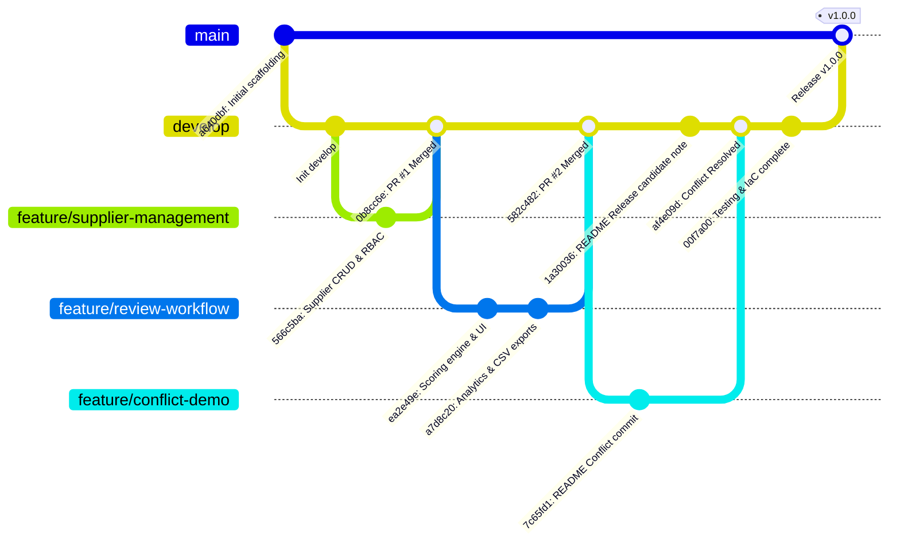

# 06 - Version Control Strategy & GitFlow Implementation

**Project Title**: Puppet-Provisioned Supplier Quality Review Portal  
**Author**: Aaditya Aswale (Student ID: 23102B0044)  
**VCS System**: Git 2.47.x Distributed Version Control  
**Branching Model**: Standard Vincent Driessen GitFlow Model  
**Active Repository Release**: `v1.0.0`

---

## 1. Branching Topology



---

## 2. Branch Governance Policies

1. **`main`**:
   - Production-ready, immutable historical release branch.
   - Every commit on `main` is tagged with a semantic version (e.g. `v1.0.0`).
   - Direct pushing to `main` is strictly prohibited. All changes arrive via fast-forward or explicit merge commits from `develop`.

2. **`develop`**:
   - Integration branch where features converge.
   - CI build triggers automatically on every push or PR targeting `develop`.

3. **`feature/*`**:
   - Ephemeral branches dedicated to isolated user stories (`feature/supplier-management`, `feature/review-workflow`).
   - Must branch off `develop` and merge back into `develop` via simulated Pull Request commits.

4. **`hotfix/*`**:
   - Urgent patches branching directly from `main` and merging into both `main` and `develop`.

---

## 3. Real Git History Verification in Project Repository

Output from `git log --graph --oneline`:
```
*   00f7a00 (develop) feat(testing & iac): add Maven Selenium E2E suite, Docker multi-stage, Jenkins declarative pipeline, and Puppet/Ansible IaC
*   af4e09d fix(git): resolve merge conflict in README between develop and feature/conflict-demo
|\  
| * 7c65fd1 docs: add conflict branch evaluation note to README
* | 1a30036 docs: add develop release candidate note to README
|/  
*   582c482 merge: pull request #2 from feature/review-workflow into develop
|\  
| * a7d8c20 feat: add analytics reporting and CSV export module
| * ea2e49e feat: implement quality review workflow, dynamic scoring engine and executive dashboard
|/  
*   0b8cc6e merge: pull request #1 from feature/supplier-management into develop
|\  
| * 566c5ba feat: implement supplier management module and RBAC foundations
|/  
* a640dbf (HEAD -> main, tag: v1.0.0) chore: initial project scaffolding and repository baseline
```
