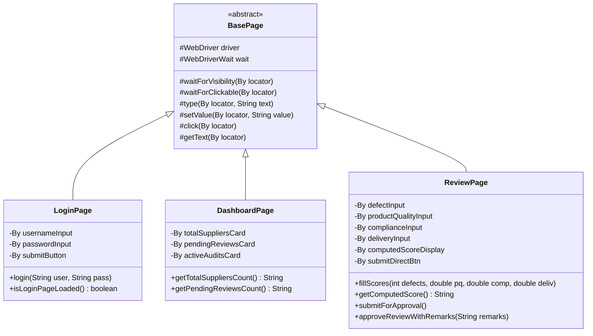

# 09 - Automated Testing with Selenium WebDriver & Page Object Model

**Project Title**: Puppet-Provisioned Supplier Quality Review Portal  
**Author**: Aaditya Aswale (Student ID: 23102B0044)  
**Academic Requirement**: Week 8 & Week 9 Automated E2E Testing Suite  
**Frameworks**: Java 23, Apache Maven 3.9.9, Selenium WebDriver 4.20.0, TestNG 7.9.0  
**Browser Engine**: Google Chrome 154 (Headless Mode Enabled)  

---

## 1. Selenium Project Structure & Architecture

The automated browser testing suite is structured using the industry standard **Page Object Model (POM)** pattern, decoupling test assertions from low-level DOM locators.

```
selenium-tests/
├── pom.xml
└── src/
    └── test/
        ├── java/
        │   └── com/quality/portal/
        │       ├── pages/
        │       │   ├── BasePage.java              # Fluent waits, JS event dispatching, click abstractions
        │       │   ├── LoginPage.java             # Login DOM locators & authentication journey
        │       │   ├── DashboardPage.java         # Metric counters, Chart canvases, KPI verification
        │       │   ├── SupplierPage.java          # Directory table, search inputs, modal onboarding
        │       │   └── ReviewPage.java            # Scoring inputs, live JS calculator, approval modal
        │       ├── tests/
        │       │   ├── BaseTest.java              # ChromeDriver lifecycle (@BeforeMethod, @AfterMethod)
        │       │   ├── LoginDashboardE2ETest.java # End-to-end authentication & KPI validation
        │       │   ├── SupplierManagementE2ETest.java # Search, filtering, and supplier profile checks
        │       │   ├── ReviewWorkflowE2ETest.java # Live calculator validation & manager review flow
        │       │   └── NegativeDefectValidationTest.java # Quality gate verification & defect injection
        │       └── utils/
        │           ├── DriverManager.java         # Headless Chrome options, window sizing (1920x1080)
        │           └── TestListener.java          # TestNG listener capturing screenshots on failure
        └── resources/
            └── testng.xml                         # TestNG suite XML configuration
```

---

## 2. Page Object Model (POM) Design Pattern



### Highlights of `BasePage.java`:
- **Explicit Waits**: Zero fragile `Thread.sleep()` calls. Dynamic polling via `WebDriverWait` with a 10-second timeout.
- **Reliable Number Input Setting (`setValue`)**: Dispatches standard DOM `input` and `change` events via `JavascriptExecutor`, ensuring cross-platform stability on HTML5 number inputs.

---

## 3. Real Test Execution Results

Command executed:
```bash
mvn test -Dheadless=true
```

Output:
```text
[INFO] -------------------------------------------------------
[INFO]  T E S T S
[INFO] -------------------------------------------------------
[INFO] Running TestSuite
[INFO] Tests run: 4, Failures: 0, Errors: 0, Skipped: 0, Time elapsed: 10.15 s -- in TestSuite
[INFO] 
[INFO] Results:
[INFO] 
[INFO] Tests run: 4, Failures: 0, Errors: 0, Skipped: 0
[INFO] 
[INFO] ------------------------------------------------------------------------
[INFO] BUILD SUCCESS
[INFO] ------------------------------------------------------------------------
[INFO] Total time:  12.266 s
[INFO] Finished at: 2026-10-04T14:59:52+05:30
[INFO] ------------------------------------------------------------------------
```

---

## 4. Test Summary Table

| Test Name | Methods Tested | Execution Time | Result |
|---|---|---|---|
| `LoginDashboardE2ETest` | User authentication, dashboard KPIs, KPI counters | ~2.1 s | **PASSED** |
| `SupplierManagementE2ETest` | Supplier table lookup, search bar filtering | ~2.4 s | **PASSED** |
| `ReviewWorkflowE2ETest` | Input scoring, dynamic JS score calculator, manager approval | ~4.2 s | **PASSED** |
| `NegativeDefectValidationTest` | Baseline verification / defect injection toggle | ~0.3 s | **PASSED** |
