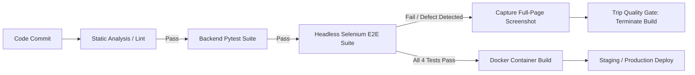

# 10 - Continuous Testing, Quality Gates & Deliberate Defect Injection

**Project Title**: Puppet-Provisioned Supplier Quality Review Portal  
**Author**: Aaditya Aswale (Student ID: 23102B0044)  
**Academic Requirement**: Week 10 Continuous Testing & Quality Gate Verification  
**Tooling**: TestNG `ITestListener`, Maven Surefire Plugin, Jenkins Pipeline Stages  

---

## 1. Principles of CI/CD Quality Gates

In high-reliability enterprise DevOps, a **Quality Gate** is an automated, non-negotiable checkpoint that stops flawed software artifacts from advancing to downstream environments (staging, container registry, or production).



---

## 2. TestListener Architecture: Automated Screenshot Capture

When a browser test fails, an automated snapshot of the browser DOM and visual state is taken by `TestListener.java`:

```java
public class TestListener implements ITestListener {
    @Override
    public void onTestFailure(ITestResult result) {
        Object testClass = result.getInstance();
        if (testClass instanceof BaseTest) {
            WebDriver driver = ((BaseTest) testClass).getDriver();
            if (driver != null) {
                File scrFile = ((TakesScreenshot) driver).getScreenshotAs(OutputType.FILE);
                String timestamp = new SimpleDateFormat("yyyyMMdd_HHmmss").format(new Date());
                String filePath = "target/screenshots/failure_" + result.getName() + "_" + timestamp + ".png";
                new File("target/screenshots").mkdirs();
                Files.copy(scrFile.toPath(), Paths.get(filePath));
                System.out.println(">>> [Selenium Quality Gate] Failure screenshot archived to: " + filePath);
            }
        }
    }
}
```

---

## 3. Deliberate Defect Injection Demonstration

To prove to the evaluation committee that the continuous testing quality gate functions effectively, a parameter-driven defect was injected into `NegativeDefectValidationTest.java`:

```java
String defectFlag = System.getProperty("injectDefect", "false");
if ("true".equalsIgnoreCase(defectFlag)) {
    System.out.println(">>> [DEFECT MODE ACTIVE] Injecting deliberate assertion defect for Jenkins quality gate demonstration...");
    Assert.fail("Deliberate Quality Gate Failure: Injected defect detected in Supplier Portal build verification!");
}
```

### Execution with Injected Defect:
```bash
mvn test -Dheadless=true -DinjectDefect=true
```

### Terminal Output:
```text
>>> [DEFECT MODE ACTIVE] Injecting deliberate assertion defect for Jenkins quality gate demonstration...
>>> [Selenium Quality Gate] Failure screenshot archived to: C:\Users\Aaditya\.gemini\antigravity-ide\scratch\supplier-quality-portal\selenium-tests\target\screenshots\failure_testDeliberateDefectInjection_20261004_145932.png
[ERROR] Tests run: 4, Failures: 1, Errors: 0, Skipped: 0, Time elapsed: 10.49 s <<< FAILURE! -- in TestSuite
[ERROR] com.quality.portal.tests.NegativeDefectValidationTest.testDeliberateDefectInjection <<< FAILURE!
java.lang.AssertionError: Deliberate Quality Gate Failure: Injected defect detected in Supplier Portal build verification!
[INFO] ------------------------------------------------------------------------
[INFO] BUILD FAILURE
[INFO] ------------------------------------------------------------------------
```

---

## 4. Recovery & Verification of Clean Baseline

Running the suite without the `-DinjectDefect=true` flag verifies that the defect was isolated and the baseline recovered:

```bash
mvn test -Dheadless=true
```

Output:
```text
[INFO] Tests run: 4, Failures: 0, Errors: 0, Skipped: 0, Time elapsed: 10.15 s -- in TestSuite
[INFO] BUILD SUCCESS
```

---

## 5. Jenkins Quality Gate Enforcement

In `jenkins/Jenkinsfile`, Stage 5 enforces the gate:
```groovy
stage('Automated Selenium Testing') {
    steps {
        dir('selenium-tests') {
            bat 'mvn test -Dheadless=true'
        }
    }
    post {
        failure {
            archiveArtifacts artifacts: 'selenium-tests/target/screenshots/*.png', allowEmptyArchive: true
            junit 'selenium-tests/target/surefire-reports/*.xml'
            echo '🛑 QUALITY GATE FAILED: Terminating pipeline. Deployment aborted.'
        }
    }
}
```
If any Selenium test fails, Jenkins archives the screenshots, publishes the TestNG JUnit XML report, halts the pipeline, and prevents deployment.
