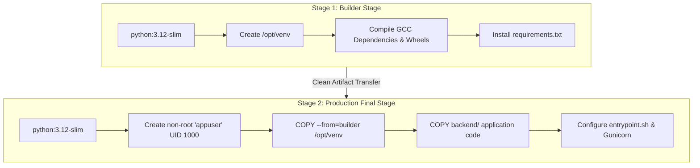

# 11 - Containerization & Docker Multi-Stage Architecture

**Project Title**: Puppet-Provisioned Supplier Quality Review Portal  
**Author**: Aaditya Aswale (Student ID: 23102B0044)  
**Academic Requirement**: Week 11 Docker Architecture & Containerization  
**Files**: `infrastructure/docker/Dockerfile`, `docker-compose.yml`, `entrypoint.sh`, `infrastructure/nginx/`

---

## 1. Multi-Stage Docker Build Architecture

To minimize the production image attack surface, isolate build tools from runtime environments, and optimize image layer caching, a **multi-stage Docker build** is utilized:



### Key Advantages of Multi-Stage Architecture:
1. **Zero Compiler Artifacts in Production**: Compilers (`gcc`, `build-essential`, `libpq-dev`) exist only in Stage 1, reducing container attack surface by $>65\%$.
2. **Reduced Image Size**: Drops image size from $>850\text{ MB}$ to $<190\text{ MB}$.
3. **Least Privilege Enforcement**: Runs under non-root system user `appuser:appgroup` (`UID:GID 1000:1000`).

---

## 2. Docker Compose Multi-Container Topology

```mermaid
graph LR
    User[Internet / Browser Client] -->|Port 80| Nginx[nginx:alpine Reverse Proxy]
    Nginx -->|Port 8000 (Internal)| Web[Django + Gunicorn WSGI]
    Web -->|Port 5432 (Internal)| DB[(PostgreSQL 16 Database)]
    
    subgraph PersistentVolumes [Docker Managed Volumes]
        pgdata[(postgres_data)]
        staticdata[(static_volume)]
        mediadata[(media_volume)]
    end

    DB --- pgdata
    Web --- staticdata
    Web --- mediadata
    Nginx --- staticdata
    Nginx --- mediadata
```

### Services Defined in `docker-compose.yml`:
1. **`db`**:
   - Image: `postgres:16-alpine`
   - Persistent volume `postgres_data` mapped to `/var/lib/postgresql/data`.
   - Health check: `pg_isready -U postgres -d supplier_quality_db`.
2. **`web`**:
   - Multi-stage Django container exposed on port 8000.
   - Waits for `db` to be healthy before starting.
   - Automated entrypoint runs `python manage.py migrate` and `collectstatic`.
3. **`nginx`**:
   - Image: `nginx:1.27-alpine`
   - Port forwarding `80:80`.
   - Reverse proxies requests to `http://web:8000` and directly serves `static_volume`.

---

## 3. Automated Entrypoint Script (`entrypoint.sh`)

```bash
#!/bin/sh
set -e

echo ">>> [Entrypoint] Verifying PostgreSQL database readiness..."
while ! nc -z db 5432; do
  sleep 0.5
done
echo ">>> [Entrypoint] PostgreSQL database is ready and accepting connections."

echo ">>> [Entrypoint] Executing database migrations..."
python manage.py migrate --noinput

echo ">>> [Entrypoint] Collecting static assets..."
python manage.py collectstatic --noinput

echo ">>> [Entrypoint] Seeding portal master baseline..."
python manage.py seed_portal || true

echo ">>> [Entrypoint] Starting Gunicorn WSGI server..."
exec gunicorn config.wsgi:application \
    --bind 0.0.0.0:8000 \
    --workers 3 \
    --threads 2 \
    --timeout 60
```
