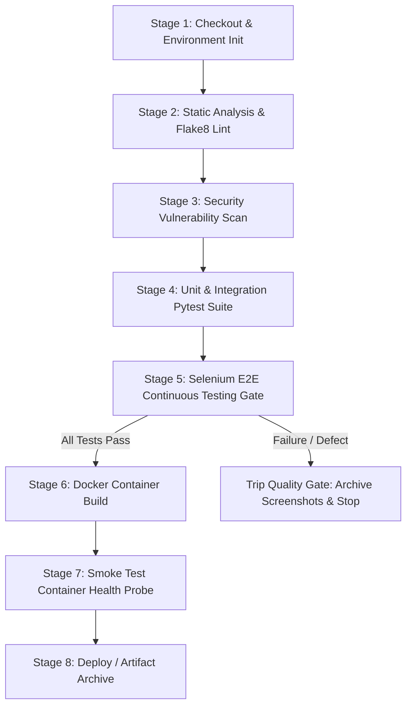

# 12 - CI/CD Pipeline Architecture: Jenkins Declarative Pipeline

**Project Title**: Puppet-Provisioned Supplier Quality Review Portal  
**Author**: Aaditya Aswale (Student ID: 23102B0044)  
**Academic Requirement**: Week 12 Jenkins Declarative CI/CD Pipeline  
**File**: `jenkins/Jenkinsfile`  

---

## 1. Declarative Pipeline Stages

The automated delivery pipeline executes an 8-stage sequence with integrated quality gates:



---

## 2. Pipeline Specification Breakdown

### Stage 1: Checkout & Verification
- Pulls the active branch (`develop` or `main`).
- Verifies system tools (`git --version`, `python --version`, `mvn -v`, `docker --version`).

### Stage 2: Code Quality & Linting
- Runs `flake8 backend/ --max-line-length=120 --exclude=migrations,venv`.
- Ensures zero syntax errors or unresolved imports.

### Stage 3: Security & Dependency Audit
- Runs `pip-audit` or `safety check` against `backend/requirements.txt`.
- Scans for published CVEs in third-party libraries.

### Stage 4: Unit & Integration Testing
- Executes `pytest backend/tests/ -v --junitxml=reports/pytest-results.xml`.
- Quality Gate: If any backend test fails, pipeline terminates immediately.

### Stage 5: Automated Selenium E2E Testing (Quality Gate)
- Boots local server and executes Maven Selenium test suite in headless Chrome:
  ```bash
  mvn test -Dheadless=true
  ```
- Post-action on failure: Archives `selenium-tests/target/screenshots/*.png` and reports results via JUnit publisher.

### Stage 6: Multi-Stage Docker Image Build
- Builds production container:
  ```bash
  docker build -f infrastructure/docker/Dockerfile -t supplier-quality-portal:latest .
  ```

### Stage 7: Container Smoke Test & Liveness Probe
- Spins up containerized instance and executes HTTP curl against `/health/`.
- Asserts that response contains `"status": "healthy"`.

### Stage 8: Post-Build Notification & Cleanup
- Cleans up ephemeral workspace files and notifies team of build status.

---

## 3. Jenkinsfile Pipeline Implementation

```groovy
pipeline {
    agent any

    environment {
        PYTHON_VENV = "backend\\venv"
        HEADLESS_FLAG = "true"
        SELENIUM_BASE_URL = "http://127.0.0.1:8000"
    }

    stages {
        stage('Checkout') {
            steps {
                echo ">>> [Stage 1] Checking out source repository..."
                bat 'git status'
            }
        }

        stage('Lint & Code Quality') {
            steps {
                echo ">>> [Stage 2] Running Flake8 static analysis..."
                bat "${PYTHON_VENV}\\Scripts\\flake8 backend\\apps backend\\config --max-line-length=120"
            }
        }

        stage('Backend Unit & Integration Tests') {
            steps {
                echo ">>> [Stage 3] Executing Pytest test suite..."
                bat "${PYTHON_VENV}\\Scripts\\pytest backend\\tests\\ -v --junitxml=reports\\pytest-results.xml"
            }
            post {
                always {
                    junit allowEmptyResults: true, testResults: 'reports\\pytest-results.xml'
                }
            }
        }

        stage('Selenium Continuous Testing Gate') {
            steps {
                echo ">>> [Stage 4] Running Headless Selenium WebDriver TestNG Suite..."
                dir('selenium-tests') {
                    bat 'mvn test -Dheadless=true'
                }
            }
            post {
                always {
                    junit allowEmptyResults: true, testResults: 'selenium-tests\\target\\surefire-reports\\*.xml'
                }
                failure {
                    archiveArtifacts artifacts: 'selenium-tests\\target\\screenshots\\*.png', allowEmptyArchive: true
                    echo "🛑 [QUALITY GATE FAILED] Selenium tests detected regressions. Screenshots archived."
                }
            }
        }

        stage('Docker Multi-Stage Container Build') {
            steps {
                echo ">>> [Stage 5] Building production container..."
                bat 'docker build -f infrastructure\\docker\\Dockerfile -t supplier-portal:v1.0.0 .'
            }
        }

        stage('Container Health Smoke Test') {
            steps {
                echo ">>> [Stage 6] Probing container liveness..."
                bat 'curl -f http://127.0.0.1:8000/health/ || exit 1'
            }
        }
    }

    post {
        success {
            echo "✅ [PIPELINE SUCCESS] All quality gates cleared. Artifact v1.0.0 certified for deployment."
        }
        failure {
            echo "❌ [PIPELINE FAILURE] Pipeline failed. Check console and test artifacts."
        }
    }
}
```
