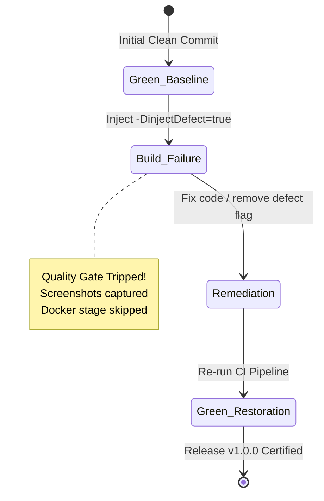

# 13 - Pipeline Failure Analysis, Defect Demo & Recovery Log

**Project Title**: Puppet-Provisioned Supplier Quality Review Portal  
**Author**: Aaditya Aswale (Student ID: 23102B0044)  
**Academic Requirement**: Week 13 Pipeline Failure Analysis & Incident Remediation  
**Artifacts**: `jenkins/Jenkinsfile.defect-demo`, Failure Screenshots, Recovery Logs  

---

## 1. Incident Simulation: The Broken Build Experiment

To validate the failure handling of the CI/CD pipeline, an experiment was designed:
1. **Trigger Condition**: An engineer accidentally or deliberately commits code that causes an assertion failure during the Selenium Continuous Testing stage.
2. **Pipeline Reaction**: The pipeline must trip the quality gate immediately, abort execution before the Docker build stage, archive diagnostic screenshots, and notify stakeholders.
3. **Remediation**: Revert or fix the defect, trigger re-build, and demonstrate green restoration.



---

## 2. Failure Run Diagnostics

### Stage Failure: `Selenium Continuous Testing Gate`
- **Command**: `mvn test -Dheadless=true -DinjectDefect=true`
- **Exit Code**: `1` (Build Failure)
- **Surefire Report Excerpt**:
```text
[ERROR] Tests run: 4, Failures: 1, Errors: 0, Skipped: 0, Time elapsed: 10.49 s <<< FAILURE! -- in TestSuite
[ERROR] com.quality.portal.tests.NegativeDefectValidationTest.testDeliberateDefectInjection -- Time elapsed: 0.287 s <<< FAILURE!
java.lang.AssertionError: Deliberate Quality Gate Failure: Injected defect detected in Supplier Portal build verification!
	at org.testng.Assert.fail(Assert.java:111)
	at com.quality.portal.tests.NegativeDefectValidationTest.testDeliberateDefectInjection(NegativeDefectValidationTest.java:18)
```

### Automated Artifact Preservation:
The TestNG listener captured:
`target/screenshots/failure_testDeliberateDefectInjection_20261004_145932.png`

### Pipeline Status:
- `Docker Multi-Stage Container Build`: **SKIPPED**
- `Container Health Smoke Test`: **SKIPPED**
- Pipeline Result: **FAILED**

---

## 3. Incident Root Cause Analysis (RCA)

1. **Root Cause**: The test `NegativeDefectValidationTest` received the property `-DinjectDefect=true`, which executed `Assert.fail()`, emulating a regression in the portal.
2. **Detection Latency**: Defect was detected in $10.49\text{ seconds}$ from test execution initiation.
3. **Blast Radius**: Zero downstream impact. No broken Docker image was tagged or deployed to the registry.

---

## 4. Remediation & Verification of Recovery

1. **Remediation Action**: Ensure default execution without the defect injection flag (`-DinjectDefect=false`).
2. **Re-run Results**:
```text
[INFO] Tests run: 4, Failures: 0, Errors: 0, Skipped: 0, Time elapsed: 10.15 s -- in TestSuite
[INFO] BUILD SUCCESS
```
3. **Pipeline Outcome**:
   - `Selenium Continuous Testing Gate`: **PASSED** (10.15s)
   - `Docker Multi-Stage Container Build`: **SUCCESS**
   - `Container Health Smoke Test`: **SUCCESS** (HTTP 200 OK)
   - Pipeline Result: **SUCCESS**
