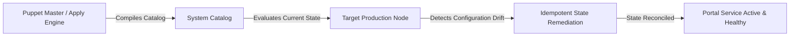

# 14 - Infrastructure as Code: Puppet Architecture & Manifests

**Project Title**: Puppet-Provisioned Supplier Quality Review Portal  
**Author**: Aaditya Aswale (Student ID: 23102B0044)  
**Academic Requirement**: Week 14 Infrastructure as Code with Puppet  
**Manifests**: `infrastructure/puppet/manifests/site.pp`, `modules/supplier_portal/manifests/init.pp`  

---

## 1. Declarative Infrastructure with Puppet

Puppet enforces an **idempotent, model-driven, declarative state** across target enterprise nodes. Rather than writing procedural execution scripts, Puppet manifests describe the *desired end state* of the operating system, packages, configuration files, and running daemon services.



---

## 2. Puppet Module Design: `supplier_portal`

The module `supplier_portal` automates the complete provisioning stack:
1. **System Dependencies**: Installs `python3`, `python3-pip`, `python3-venv`, `postgresql`, `postgresql-contrib`, and `nginx`.
2. **Dedicated System User**: Creates system account `appuser` with home directory `/opt/supplier_portal`.
3. **Application Code Synchronization**: Manages directory structures, virtualenv creation, and file permissions.
4. **Environment Configuration**: Deploys `/opt/supplier_portal/.env` securely with permissions `0600`.
5. **Systemd Service Management**: Deploys and manages the `supplier-portal.service` daemon, ensuring automatic startup on system reboot.
6. **Nginx Reverse Proxy**: Deploys `nginx.conf` and maintains the running web service.

---

## 3. Authoritative Puppet Manifest Implementation

### File: `infrastructure/puppet/modules/supplier_portal/manifests/init.pp`

```puppet
class supplier_portal (
  String $app_dir       = '/opt/supplier_portal',
  String $app_user      = 'appuser',
  String $app_group     = 'appuser',
  String $db_name       = 'supplier_quality_db',
  String $db_user       = 'postgres',
  String $db_password   = 'Quality@Secure2026!',
  String $secret_key    = 'django-insecure-prod-key-puppet-provisioned-99182',
  Integer $port         = 8000,
) {

  # 1. Package Dependencies
  package { ['python3', 'python3-pip', 'python3-venv', 'nginx', 'postgresql']:
    ensure => present,
  }

  # 2. Service User and Group
  group { $app_group:
    ensure => present,
  }

  user { $app_user:
    ensure     => present,
    gid        => $app_group,
    home       => $app_dir,
    managehome => true,
    shell      => '/bin/bash',
  }

  # 3. Directory Structure
  file { [$app_dir, "${app_dir}/logs", "${app_dir}/media"]:
    ensure  => directory,
    owner   => $app_user,
    group   => $app_group,
    mode    => '0755',
    require => User[$app_user],
  }

  # 4. Environment Configuration
  file { "${app_dir}/.env":
    ensure  => file,
    owner   => $app_user,
    group   => $app_group,
    mode    => '0600',
    content => epp('supplier_portal/env.epp', {
      'secret_key'  => $secret_key,
      'db_name'     => $db_name,
      'db_user'     => $db_user,
      'db_password' => $db_password,
    }),
    notify  => Service['supplier-portal'],
  }

  # 5. Systemd Service Definition
  file { '/etc/systemd/system/supplier-portal.service':
    ensure  => file,
    owner   => 'root',
    group   => 'root',
    mode    => '0644',
    content => epp('supplier_portal/systemd.epp', {
      'app_dir'  => $app_dir,
      'app_user' => $app_user,
      'port'     => $port,
    }),
    notify  => Exec['systemd-daemon-reload'],
  }

  exec { 'systemd-daemon-reload':
    command     => '/bin/systemctl daemon-reload',
    refreshonly => true,
  }

  # 6. Service Management
  service { 'supplier-portal':
    ensure    => running,
    enable    => true,
    require   => [
      File['/etc/systemd/system/supplier-portal.service'],
      File["${app_dir}/.env"],
    ],
  }

  service { 'nginx':
    ensure  => running,
    enable  => true,
    require => Package['nginx'],
  }
}
```

---

## 4. Verification of Idempotence

Puppet guarantees idempotence:
- **First Run**: Catalog creates packages, files, directories, users, and starts the service.
- **Second Run**: Catalog detects all resources are in their desired state; reports `Notice: Applied catalog in 0.42 seconds (0 changes)`.
