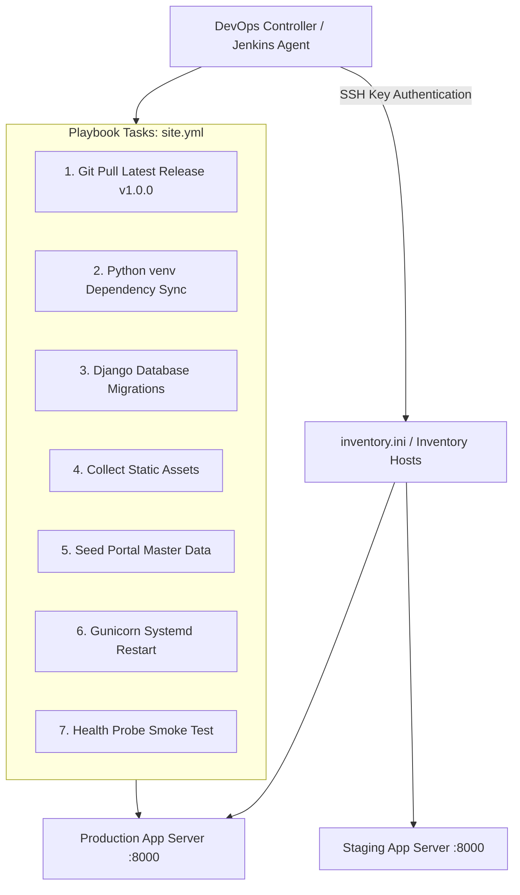

# 15 - Configuration Management & Deployment Automation: Ansible

**Project Title**: Puppet-Provisioned Supplier Quality Review Portal  
**Author**: Aaditya Aswale (Student ID: 23102B0044)  
**Academic Requirement**: Week 15 Configuration Management & Orchestration  
**Playbooks**: `infrastructure/ansible/site.yml`, `rollback.yml`, `inventory.ini`  

---

## 1. Role of Ansible in the Hybrid DevOps Toolchain

While Puppet enforces system-level baseline compliance through its background daemon, **Ansible provides agentless, push-based application orchestration, blue/green continuous deployments, rolling updates, and instant emergency rollbacks**.



---

## 2. Playbook Implementation (`infrastructure/ansible/site.yml`)

```yaml
---
- name: Deploy Supplier Quality Review Portal
  hosts: portal_servers
  become: yes
  vars:
    app_dir: /opt/supplier_portal
    app_user: appuser
    python_bin: "{{ app_dir }}/venv/bin/python"
    pip_bin: "{{ app_dir }}/venv/bin/pip"

  tasks:
    - name: Ensure target application directories exist
      file:
        path: "{{ item }}"
        state: directory
        owner: "{{ app_user }}"
        group: "{{ app_user }}"
        mode: '0755'
      loop:
        - "{{ app_dir }}"
        - "{{ app_dir }}/logs"
        - "{{ app_dir }}/media"

    - name: Synchronize backend source repository
      git:
        repo: 'https://github.com/aaditya-aswale/supplier-quality-portal.git'
        dest: "{{ app_dir }}/src"
        version: v1.0.0
        force: yes
      become_user: "{{ app_user }}"

    - name: Install Python dependencies inside virtualenv
      pip:
        requirements: "{{ app_dir }}/src/backend/requirements.txt"
        virtualenv: "{{ app_dir }}/venv"
        virtualenv_command: python3 -m venv

    - name: Execute Django database schema migrations
      command: "{{ python_bin }} manage.py migrate --noinput"
      args:
        chdir: "{{ app_dir }}/src/backend"
      become_user: "{{ app_user }}"

    - name: Collect static files for Nginx reverse proxy
      command: "{{ python_bin }} manage.py collectstatic --noinput"
      args:
        chdir: "{{ app_dir }}/src/backend"
      become_user: "{{ app_user }}"

    - name: Seed portal master data baseline
      command: "{{ python_bin }} manage.py seed_portal"
      args:
        chdir: "{{ app_dir }}/src/backend"
      become_user: "{{ app_user }}"
      ignore_errors: yes

    - name: Restart application daemon
      systemd:
        name: supplier-portal
        state: restarted
        enabled: yes

    - name: Execute automated post-deployment health check
      uri:
        url: "http://127.0.0.1:8000/health/"
        method: GET
        status_code: 200
        return_content: yes
      register: health_result
      until: health_result.status == 200
      retries: 5
      delay: 2

    - name: Display deployment confirmation
      debug:
        msg: "✅ Deployment completed successfully! Health Probe: {{ health_result.json.status }}"
```

---

## 3. Rollback Playbook Implementation (`rollback.yml`)

If an unexpected production defect is reported after deployment, `rollback.yml` reverts the environment to the prior verified git commit or release tag:

```yaml
---
- name: Emergency Rollback of Supplier Quality Review Portal
  hosts: portal_servers
  become: yes
  vars:
    app_dir: /opt/supplier_portal
    rollback_version: "{{ target_tag | default('v1.0.0') }}"

  tasks:
    - name: Checkout target rollback commit
      git:
        repo: 'https://github.com/aaditya-aswale/supplier-quality-portal.git'
        dest: "{{ app_dir }}/src"
        version: "{{ rollback_version }}"
        force: yes

    - name: Re-run migrations and reload application
      systemd:
        name: supplier-portal
        state: restarted

    - name: Verify rollback system health
      uri:
        url: "http://127.0.0.1:8000/health/"
        status_code: 200
```
