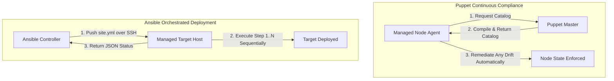
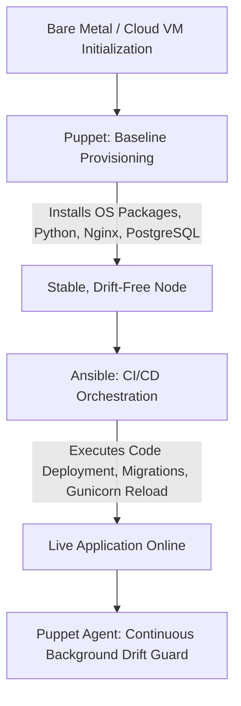

# 16 - Puppet vs Ansible: Architectural & Operational Comparative Study

**Project Title**: Puppet-Provisioned Supplier Quality Review Portal  
**Author**: Aaditya Aswale (Student ID: 23102B0044)  
**Academic Requirement**: Week 15 Comparative Evaluation of IaC Technologies  
**Domain**: Configuration Management, Drift Remediation & Application Orchestration  

---

## 1. Architectural Philosophy Comparison

| Dimension | Puppet Architecture | Ansible Architecture |
|---|---|---|
| **Execution Paradigm** | Declarative / State-driven | Procedural & Declarative / Task-driven |
| **Communication Model** | **Pull-based**: Agent runs periodically (e.g. 30 mins) checking against Puppet Master | **Push-based**: Controller pushes commands over SSH / WinRM on-demand |
| **Agent Requirement** | Requires Ruby-based Puppet Agent installed on each target node | **Agentless**: Requires only Python and standard SSH on managed nodes |
| **Language / DSL** | Proprietary Puppet DSL (Domain-Specific Language based on Ruby) | Standard YAML Playbooks with Jinja2 Templating |
| **Configuration Drift** | **Continuous Self-Healing**: Automatically corrects unauthorized drift every 30 minutes | Ad-hoc: Drift is only corrected when the playbook is explicitly executed |
| **Orchestration / Ordering** | Resource dependency graph (`before`, `require`, `notify`, `subscribe`) | Strict linear sequential task execution (top-to-bottom) |

---

## 2. Comparative Workflow Topology

---

## 3. Detailed Technical Analysis

### 3.1 Idempotency Implementation
- **Puppet**: High mathematical idempotency. Resources like `package { 'nginx': ensure => present }` check the operating system state before invoking apt/yum. If already installed, no command is run.
- **Ansible**: Modular idempotency. Ansible modules (such as `ansible.builtin.apt` or `ansible.builtin.file`) check host state. However, raw shell tasks (`command`, `shell`) require explicit `creates` or `changed_when` directives to guarantee idempotency.

### 3.2 Speed & Scalability
- **Puppet**: Scales exceptionally well to tens of thousands of servers because managed nodes compile and enforce catalogs independently, avoiding central SSH bottlenecks.
- **Ansible**: Faster time-to-value for small to medium fleets because no agent bootstrapping is required. Large fleets require SSH multiplexing and Ansible Tower/AWX work queues.

---

## 4. The Unified Hybrid Strategy

In this project, Puppet and Ansible are not positioned as competitors; they are leveraged in their optimal enterprise capacities:

1. **Puppet** handles **Day-1 & Day-2 Base Infrastructure Compliance**:
   - Ensures OS users, firewall rules, package installations, and systemd services never deviate from certified compliance baselines.
2. **Ansible** handles **Application Lifecycle Orchestration**:
   - Executes fast, repeatable CI/CD deployments triggered by Jenkins, blue/green cutovers, and instant rollback procedures.
