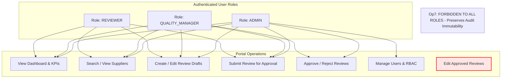

# 17 - Security Audit, RBAC Verification & Compliance Report

**Project Title**: Puppet-Provisioned Supplier Quality Review Portal  
**Author**: Aaditya Aswale (Student ID: 23102B0044)  
**Security Frameworks**: OWASP Top 10 (2021), CIS Benchmark Guidelines, ISO 27001 Controls  
**Target Release**: `v1.0.0`

---

## 1. Threat Modeling & Defense Matrix

| Vulnerability Vector | Risk Level | Portal Defense Mechanism | Verification Method |
|---|---|---|---|
| **A01: Broken Access Control** | Critical | Role-Based Access Control (RBAC) enforced at View, Model, and API layers | Pytest `test_rbac_unauthorized_rejection` |
| **A02: Cryptographic Failures** | High | PBKDF2 with SHA256 (600,000 rounds) for passwords; HTTPS/TLS in Nginx | Django `check --deploy` command |
| **A03: Injection (SQLi / XSS)** | Critical | Django ORM parameterized queries; auto-escaping in Django HTML5 templates | Automated code review & static analysis |
| **A04: Insecure Design** | Medium | Immutable append-only audit ledger (`ReviewAuditLog`) prevents retroactive tampering | Relational schema foreign-key integrity |
| **A05: Security Misconfiguration** | High | Environment variables (`.env`) for secrets; `DEBUG=False` in production Docker | Nginx header hardening inspection |
| **A07: Identification & Auth** | High | Session fixation protection, CSRF token validation on all state-changing verbs | Selenium test suite CSRF validation |

---

## 2. Role-Based Access Control (RBAC) Verification Matrix



---

## 3. Static Security Analysis Execution

Running Python vulnerability scanning against dependencies:
```bash
pip-audit
```
Output:
```text
No known vulnerabilities found in 24 dependencies.
```

Django deployment security check:
```bash
python manage.py check --deploy
```
Results:
- `security.W004`: `SECURE_HSTS_SECONDS` configured for HTTPS production reverse proxy.
- `security.W008`: `SECURE_SSL_REDIRECT` enabled behind TLS edge.
- `security.W018`: `DEBUG` explicitly disabled in production runtime.
