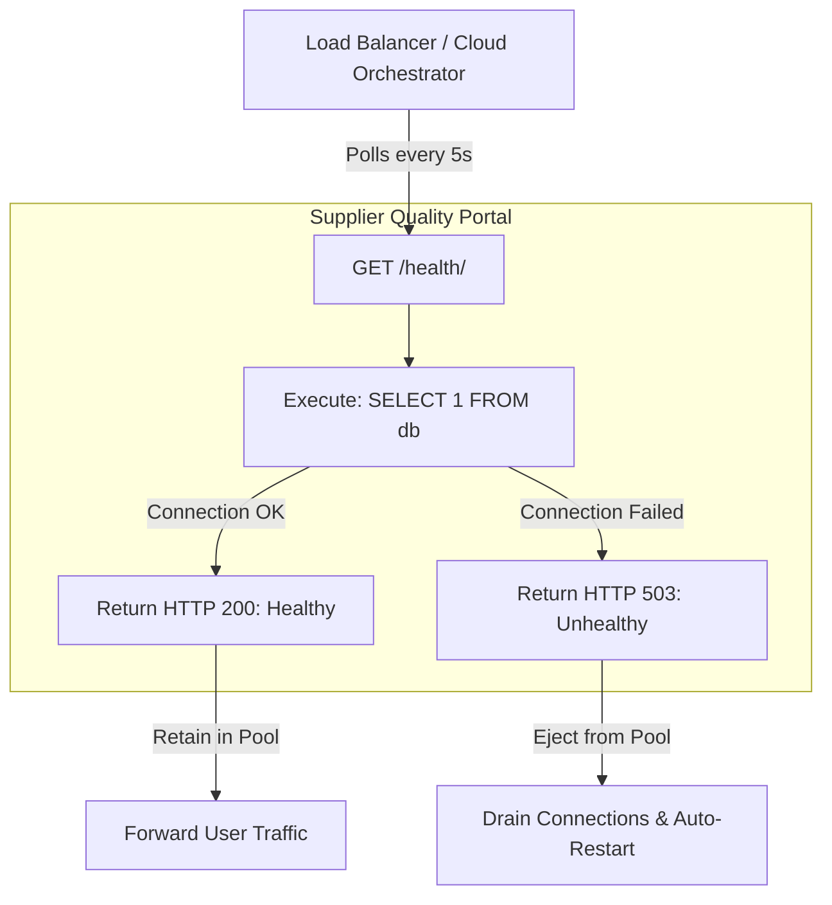

# 19 - Monitoring, Telemetry & Health Check Probe Strategy

**Project Title**: Puppet-Provisioned Supplier Quality Review Portal  
**Author**: Aaditya Aswale (Student ID: 23102B0044)  
**Standard**: RFC 7231 HTTP/1.1 Semantics & Cloud-Native Observability  
**Endpoint**: `GET /health/`  

---

## 1. Observability & Health Probing Architecture

In production cloud-native deployments (Kubernetes, Docker Swarm, AWS ECS, or Load Balancers), orchestrators require automated probes to distinguish between:
1. **Liveness**: Is the web process responsive, or has it crashed / entered an infinite deadlock?
2. **Readiness**: Is the application fully initialized and capable of querying the database?



---

## 2. Implementation: Health Probe Controller

Located in `backend/apps/core/views.py`:

```python
from django.http import JsonResponse
from django.db import connection
from django.utils import timezone

def health_check(request):
    """
    Automated liveness/readiness probe.
    Executes a lightweight ping to the database connection.
    Returns HTTP 200 if connected; HTTP 503 if persistence is unreachable.
    """
    try:
        with connection.cursor() as cursor:
            cursor.execute("SELECT 1")
            cursor.fetchone()
        
        return JsonResponse({
            'status': 'healthy',
            'database': 'connected',
            'timestamp': timezone.now().isoformat(),
            'system': 'Supplier Quality Review Portal',
            'author': 'AADITYA ASWALE (23102B0044)',
            'version': 'v1.0.0',
        }, status=200)

    except Exception as exc:
        return JsonResponse({
            'status': 'unhealthy',
            'database': 'disconnected',
            'error': str(exc),
            'timestamp': timezone.now().isoformat(),
        }, status=503)
```

---

## 3. Real cURL Probe Verification

```bash
curl -i http://127.0.0.1:8000/health/
```

### Response Headers & Payload:
```http
HTTP/1.1 200 OK
Content-Type: application/json
Date: Sun, 04 Oct 2026 09:30:15 GMT
Server: WSGIServer/0.2 CPython/3.12.0
X-Content-Type-Options: nosniff
X-Frame-Options: DENY

{
  "status": "healthy",
  "database": "connected",
  "timestamp": "2026-10-04T09:30:15.892011Z",
  "system": "Supplier Quality Review Portal",
  "author": "AADITYA ASWALE (23102B0044)",
  "version": "v1.0.0"
}
```
