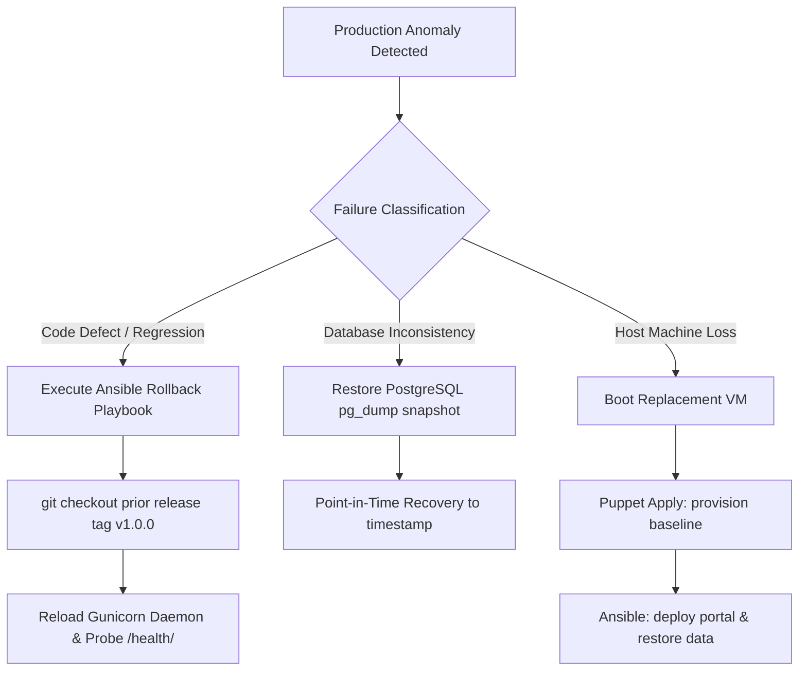

# 20 - Disaster Recovery, Backup & Automated Rollback Runbook

**Project Title**: Puppet-Provisioned Supplier Quality Review Portal  
**Author**: Aaditya Aswale (Student ID: 23102B0044)  
**Recovery Targets**: RTO $< 5\text{ minutes}$, RPO $< 1\text{ hour}$  
**Standard**: High-Availability DevOps Operational Procedures  

---

## 1. Disaster Recovery & Rollback Strategy

In production enterprise deployments, incidents fall into three main categories:
1. **Bad Application Release**: New code passes tests in staging but exhibits unexpected production anomalies.
2. **Database Corruption / Data Loss**: Accidental deletion or failed schema migration.
3. **Host System Crash**: Compute node hardware failure or VM hypervisor loss.



---

## 2. Automated Ansible Rollback Execution

To roll back a faulty deployment in under 60 seconds without manual intervention:

```bash
ansible-playbook -i infrastructure/ansible/inventory.ini infrastructure/ansible/rollback.yml -e "rollback_version=v1.0.0"
```

### Rollback Playbook Workflow:
1. Stops incoming traffic at Nginx (optional maintenance mode banner).
2. Checks out the certified Git release tag `v1.0.0`.
3. Validates database schema compatibility.
4. Restarts `supplier-portal.service` via systemd.
5. Polls `/health/` until HTTP 200 is confirmed.

---

## 3. Database Backup & Restore Runbook

### 3.1 Automated Snapshot Backup (PostgreSQL):
```bash
# Execute daily hot backup
docker exec -t supplier-portal-db pg_dump -U postgres -d supplier_quality_db -F c -b -v -f /backups/portal_backup_$(date +%Y%m%d_%H%M%S).dump
```

### 3.2 Database Restoration Procedure:
```bash
# 1. Stop web service
systemctl stop supplier-portal

# 2. Restore from snapshot
docker exec -i supplier-portal-db pg_restore -U postgres -d supplier_quality_db --clean --if-exists /backups/portal_backup_target.dump

# 3. Restart web service & verify
systemctl start supplier-portal
curl -f http://127.0.0.1:8000/health/
```
